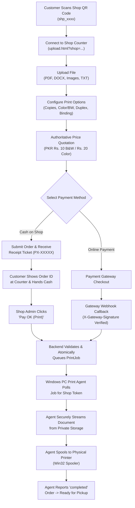

# PrintX — Product Requirements Document (PRD)

**Version:** 2.0  
**Status:** Approved & Implemented  
**Date:** November 2026  
**Audience:** Product Managers, Engineering Teams, Shop Operators, Security Auditors  

---

## 1. Product Vision & Problem Statement

### 1.1 The Problem
In campus areas, markets, and commercial zones, customers needing document printing face persistent friction:
1. **Inefficient Transfer Methods**: Customers are forced to email files, connect unverified USB flash drives (spreading malware), or message personal WhatsApp numbers of shopkeepers.
2. **Account Creation Fatigue**: Walk-in customers printing a 2-page document resist registering an account, verifying emails, or installing native apps.
3. **Queue Inefficiencies**: Shopkeepers waste time downloading, checking page counts, estimating pricing manually, and selecting print settings.
4. **Hardware Bottlenecks**: Counter staff must manually click through printer dialogs while managing in-person queues.

### 1.2 The PrintX Solution
PrintX is a contactless, kiosk-style, multi-shop cloud printing platform that eliminates account registration barriers for walk-in customers:
* **Scan & Print Kiosk Mode**: Scanning a shop counter QR code routes customers directly to that counter's upload flow.
* **Multi-Format Support**: Instant upload of PDFs, Word documents, images, and text with authoritative backend page detection.
* **Authoritative PKR Pricing**: Instant pricing quotations for B&W and color copies, duplex discounts, and finishing options.
* **Dual Automatic Printing**:
  * **Method 1**: Online payment verification via gateway webhook triggers automatic physical spooling.
  * **Method 2**: Admin single-click counter cash verification ("Pay OK") triggers automatic physical spooling without a second button click.
* **Windows PC Print Agent**: Hardened background spooler agent running on the counter PC directly bridges cloud print jobs to local physical printers.

---

## 2. User Personas

### Persona 1: Counter Walk-In Customer (Student / Professional)
* **Goal**: Needs documents printed immediately at a shop counter without signing up.
* **Behavior**: Scans counter QR code with mobile phone, uploads document, picks print settings, confirms order, receives a brief Order ID token ticket (`PX-XXXXX`), pays cash or online, collects fresh prints.

### Persona 2: Print Shop Owner / Administrator
* **Goal**: Maximize queue throughput, eliminate malware from flash drives, track revenue, and automate printing.
* **Behavior**: Displays official counter QR code stand, monitors incoming orders on dashboard, clicks `Pay OK (Print)` upon receiving cash, and lets the PC Print Agent spool paper output automatically.

---

## 3. Product Workflows & User Journeys

---

## 4. Feature Specifications

### 4.1 Customer Experience (Kiosk Mode)
1. **Zero Registration**: Customers access the platform without entering passwords, emails, or personal credentials.
2. **Shop Identification**: Unique shop public identifiers (`shp_...`) are passed via QR parameter.
3. **Multi-Format Document Upload**:
   * Accepts `.pdf`, `.png`, `.jpg`, `.jpeg`, `.webp`, `.doc`, `.docx`, `.txt`.
   * Enforces 50 MB maximum size limit.
   * Authoritative page extraction using `pypdf` for PDF files; single-page normalization for images and single documents.
4. **Authoritative Quotation (PKR)**:
   * **Black & White**: Rs. 10.00 / page.
   * **Full Color**: Rs. 20.00 / page.
   * **Duplex**: 10% discount on page cost.
   * **Paper Size**: A4 / Letter (1.0x), A3 (1.5x).
   * **Finishing / Binding**: Loose (Rs. 0), Corner Staple (+Rs. 10), Spiral Bound (+Rs. 50), Hardcover (+Rs. 150).
5. **Confirmation Ticket Slip**:
   * Prominently displays high-contrast Order ID (`PX-XXXXX`).
   * Displays exact total due, document name, selected shop name.
   * Provides single-click "Track This Order" link.
6. **Order Tracking**:
   * 5-stage progress indicator: `Order Placed` → `Confirmed` → `Printing` → `Ready for Pickup` → `Completed`.
   * Accessible by Order Number (`PX-XXXXX`) or unique single-use access token.

### 4.2 Shop Owner & Admin Experience
1. **Authentication**: Email/password authentication returning scoped token; session guard redirects unauthorized requests.
2. **Live Counter Dashboard**:
   * Real-time metrics: Total Orders, Pending Orders, Payment Pending, Completed Orders, Blocked Orders.
   * Recent orders table with live status badges.
3. **All Order Prints Queue**:
   * Status filter buttons (`All`, `Pending`, `Payment Pending`, `Printing`, `Ready for Pickup`, `Completed`, `Blocked`).
   * Live search bar (Order Number, Customer Name, Customer Phone, Document Name).
   * Server pagination (`page`, `page_size`, `total_pages`).
   * Order Details modal with linked print jobs and forensic audit trail.
4. **Order Actions**:
   * **Pay OK (Print)**: Confirms cash payment, updates payment record with admin ID and timestamp, and automatically queues print job.
   * **Reprint / Authorize Print**: Re-queues print job if paper jammed or physical error occurred.
   * **Block Order**: Permanently blocks inappropriate or malicious documents. Blocked orders can never be paid or printed.
5. **Counter QR Code Generator**:
   * Generates high-resolution PNG QR code pointing directly to `pages/upload.html?shop={public_id}`.
   * Single-click direct blob PNG download.
   * Counter display print layout with `@media print` styling.
6. **Shop & Admin Settings**:
   * Manage shop details: business name, contact phone, physical address, opening hours.
   * Manage admin identity: administrator name, personal phone, secure password changes.
   * PC Print Agent pairing token provisioning & regeneration.

---

## 5. Printing Methods & Rules

### 5.1 Method 1: Online Payment → Automatic Printing
1. Customer initiates online checkout via `/api/v1/payments/online/initiate/`.
2. When gateway keys are not yet configured, returns `status: "pending_integration"` without simulating fake payments.
3. Once gateway completes payment, trusted server-to-server webhook `/api/v1/payments/online/webhook/` receives callback.
4. Backend verifies cryptographic signature (`X-Gateway-Signature`).
5. Backend updates order to `paid` and automatically calls unified `dispatch_print_job(order, triggered_by='online_payment_verified')`.

### 5.2 Method 2: Admin Pay OK → Automatic Printing
1. Customer submits cash order; order appears in shop admin queue as `unpaid` / `pending`.
2. Admin receives cash at counter and clicks `Pay OK (Print)`.
3. Backend records payment approval with admin user ID and timestamp.
4. Backend automatically creates and queues `PrintJob` for the shop's printer.
5. **Admin never needs to click a secondary print button.**

### 5.3 Common Printing Rules
* **Strict Idempotency**: Repeated Pay OK or re-sent webhooks must never generate duplicate physical prints.
* **Blocked Orders Guard**: Blocked orders must NEVER be printed under any condition.
* **Shop Isolation**: Shop B agent can never view or spool Shop A's print jobs.
* **No Lost Jobs**: Hardware errors (offline printer, out of paper) are recorded in the database, preserving the job for re-spooling.

---

## 6. Non-Functional Requirements

1. **Security**: Zero Trust on frontend; all validations and authorization enforced by backend.
2. **Performance**: Page quotation and order submission under 200ms; agent polling under 100ms.
3. **Data Integrity**: PostgreSQL relational consistency; document files encrypted/isolated in private storage outside web root.
4. **Reliability**: Automatic reconnect and exponential backoff for PC Print Agent during network dropouts.
